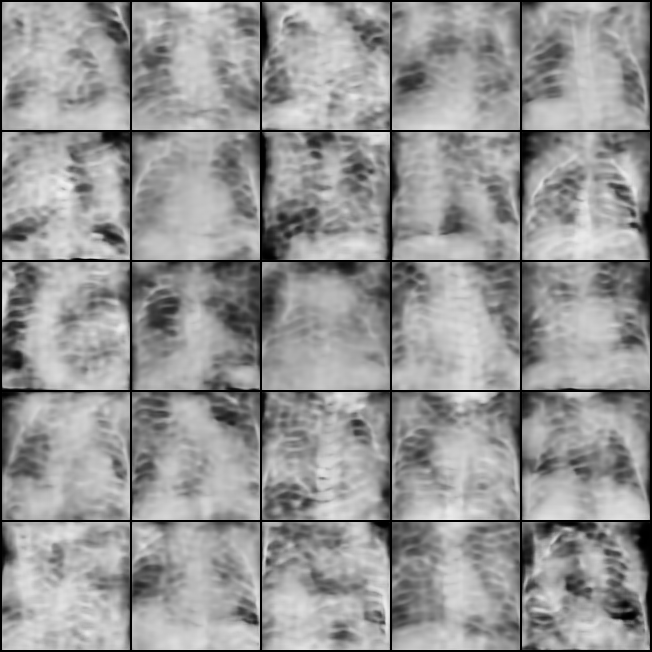

# HW1 — Variational Autoencoder

使用 Kaggle Chest X-Ray Images (Pneumonia) 第 2 版資料集，訓練純 VAE 生成 128 × 128 灰階胸腔 X 光影像。最後選用 conditional spatial VAE，包含 128 維全域變數與 4 × 16 × 16 區域變數；生成時共輸入 1,152 維標準常態雜訊。

模型使用 reconstruction loss 與 Gaussian KL 訓練，沒有 GAN、discriminator 或 adversarial loss。Inception 網路僅用於計算 FID 與 IS。

## 檔案

| 路徑 | 用途 |
| --- | --- |
| `vae.py`、`train.py` | 全域 Gaussian VAE 與從零訓練入口 |
| `spatial_vae.py`、`train_pure.py` | 最後版本的 conditional spatial VAE 與既有模型續訓入口 |
| `evaluation.py`、`evaluate.py`、`evaluate_pure.py` | 固定抽樣、FID / IS 與結果圖產生 |
| `diagnostic_metrics.py`、`run_diagnostics.py` | Reconstruction 指標與診斷實驗 |
| `download_data.py` | 下載固定版本資料集 |
| `tests/` | 純 VAE 與評估相關的 23 個單元測試 |
| `results/` | 精簡指標、完整生成 grids、比較圖與重建圖 |
| `experiments/pure_vae_v1/`、`experiments/pure_vae_v2/`、`experiments/pure_vae_spatial_v2/` | 各續訓階段的既有 JSON 設定與紀錄 |
| `experiments/diagnostics_v1/data_manifest.json` | Train-seen reconstruction monitor 的固定影像索引 |
| `artifacts/` | 原始 baseline 的既有 JSON 設定與評估紀錄 |
| `main.tex`、`report/figures/` | 報告原始碼與圖片，可上傳至 Overleaf |
| `report/Homework_1_PureVAE.pdf` | 最後的兩頁報告 |

既有 JSON 中的本機 workspace 路徑已轉成相對路徑；原始指標與 checkpoint SHA-256 保留。資料集、模型權重與 optimizer state 不在此 repo。

## 環境與資料

實驗環境為 Python 3.13，套件版本固定於 `requirements.txt`。由 repo 根目錄執行：

```bash
python3 -m venv .venv
source .venv/bin/activate
python -m pip install -r HW1/requirements.txt
cd HW1
python download_data.py --version 2
```

下載程式會建立 `data/chest_xray`，內含 `train/`、`test/` 與 `val/`。Kaggle 若要求驗證，請在本機完成登入；勿將憑證加入 Git。資料共含 5,216 張 train、624 張 test 與 16 張 val；實驗未使用官方 val。

訓練程式會依可用硬體選擇 CUDA、MPS 或 CPU。首次計算 FID / IS 時，Torchvision 需要下載 Inception 權重。

## 從零訓練與評估

以下指令不需要此 repo 未附上的既有 checkpoint，可訓練一個新的全域 VAE。輸出至 `runs/`，避免覆寫封存的實驗紀錄。

```bash
python train.py --output-dir runs/baseline --epochs 20 --seed 285 --skip-metrics
python evaluate.py --checkpoint runs/baseline/vae_checkpoint.pt --output-dir runs/baseline_evaluation --samples 512 --seed 285
```

若只要檢查訓練流程，可先執行短測試：

```bash
python train.py --output-dir runs/smoke --epochs 1 --max-train-samples 32 --batch-size 8 --skip-metrics
```

新訓練產生的模型與結果是獨立實驗，不會自動重現下方封存的最終分數。

## 最後版本與既有權重

最後選用模型並非從零開始：原始 20-epoch baseline 經兩階段全域 VAE 續訓，再轉為 conditional spatial VAE，訓練 3,000 steps。最後一階段使用 batch size 16、AdamW learning rate `1e-4` 降至 `1e-5`、KL 權重 `beta=0.1`，以及在 200 steps 內增加至 `0.2` 的 SSIM 權重。

`train_pure.py` 保留原始 checkpoint 的 SHA-256 驗證，`--resume` 與 `--warm-start` 也會檢查純 VAE 來源。完整重現這條續訓路徑，須另外取得原始 initializer 與對應階段的 warm-start / resume checkpoint。從上方 `train.py` 新訓練的模型會有不同雜湊，不能直接當作這條封存實驗的 initializer。

此 repo **未附上**下列權重，也未提供下載連結：

| 權重路徑 | SHA-256 |
| --- | --- |
| `artifacts/vae_checkpoint.pt` | `a59171e78e059a24e6be1dcaa03265f321471851a573cc54943ed874d5c7483c` |
| `experiments/pure_vae_spatial_v2/selected_model.pt` | `86444e6be01ed8cba6a484619388381cebc0bcc83b9c8c29e5e698177d56456b` |

若另行放入 selected checkpoint，即可重新產生三組固定 seed 的完整生成圖與 FID / IS；下例先跳過重建評估：

```bash
python evaluate_pure.py --checkpoint experiments/pure_vae_spatial_v2/selected_model.pt --output-dir runs/selected_evaluation --samples 512 --seed 285 --grid-seeds 285 1285 2285 --skip-reconstruction
```

若也放入原始 baseline checkpoint，可加上 `--baseline-checkpoint artifacts/vae_checkpoint.pt` 產生兩版比較圖。移除 `--skip-reconstruction` 可依 repo 保留的 split manifest 重新計算 train-seen reconstruction 指標。

## 既有結果

| 模型 | FID ↓ | IS ↑ |
| --- | ---: | ---: |
| 原始全域 VAE baseline | 376.3752 | 1.6890 |
| 最後 conditional spatial VAE | 362.7236 | 1.8698 |

兩版使用相同的 512 張 test 影像、seed 與 Inception 評估程序；生成變數維度不同，所以 Gaussian latent vectors 不同。此處採用 `torchvision-pool3-imagenet-normalized-v1`，分數不宜直接與 TensorFlow、pytorch-fid 或 Clean-FID 的結果混用。只有單一 seed、512 samples，且先前已觀察過官方 test 結果。

最後模型的 deterministic reconstruction 使用 255 張 **訓練時已見過的影像**：MAE `0.01724877`、SSIM `0.89084563`、PSNR `32.6593 dB`。這是 train-seen 診斷，不能當作 held-out validation，也不能代表隨機生成圖的清晰度。

完整數值與抽樣條件見 [`results/metrics.json`](results/metrics.json)。生成結果保留完整的每組 25 張圖，temperature 為 1，沒有逐張挑選或銳化。影像已呈現胸腔與肋骨結構，細節仍有模糊與不規則紋理。



- [Seed 1285](results/generated_seed1285.png)
- [Seed 2285](results/generated_seed2285.png)
- [Baseline / selected 比較](results/prior_comparison_seed285.png)
- [Train-seen 重建圖](results/reconstructions.png)
- [最後報告 PDF](report/Homework_1_PureVAE.pdf)

## 測試

在 `HW1/` 執行：

```bash
python -m unittest discover -s tests -p 'test_*.py'
```

測試涵蓋 Gaussian KL、SSIM、spatial VAE 與評估來源檢查，不需要下載資料集或既有權重。
