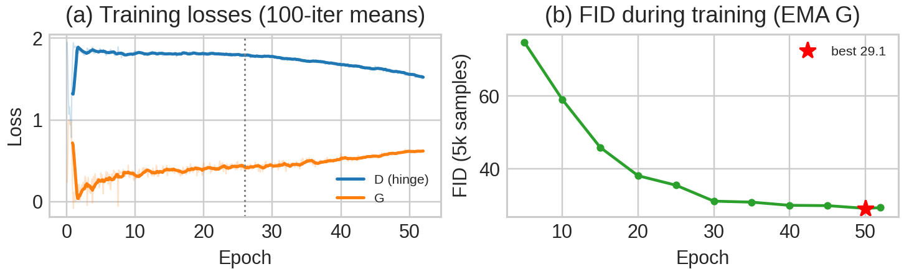
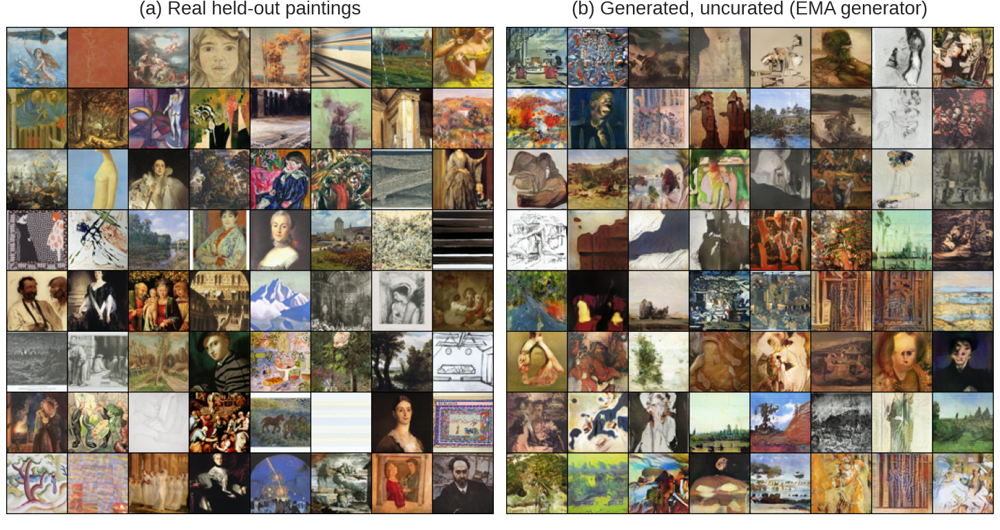

# HW2 - WikiArt Painting Generation

An unconditional residual GAN trained on 64 x 64 WikiArt paintings. The discriminator uses spectral normalization and hinge loss. Training uses separate generator and discriminator learning rates, mixed precision, and an exponential moving average (EMA) of the generator.

[Open the notebook in Colab](https://colab.research.google.com/github/moose1108/ece285-homeworks/blob/main/HW2/ECE285_HW2_Colab.ipynb)

## Files

| Path | Contents |
| --- | --- |
| [ECE285_HW2_Colab.ipynb](ECE285_HW2_Colab.ipynb) | Training, checkpoint loading, evaluation, plots, and recorded outputs |
| [ECE285_HW2_submission/report.pdf](ECE285_HW2_submission/report.pdf) | Completed report |
| [ECE285_HW2_submission/report.tex](ECE285_HW2_submission/report.tex) | Report source; compile alongside the supplied style and figures |
| [ECE285_HW2_submission/neurips_2023.sty](ECE285_HW2_submission/neurips_2023.sty) | NeurIPS style required by the report source |
| [ECE285_HW2_submission/metrics.json](ECE285_HW2_submission/metrics.json) | Full final evaluation results |
| [ECE285_HW2_submission/run_config.json](ECE285_HW2_submission/run_config.json) | Recorded configuration, dataset counts, model sizes, and hardware |
| [ECE285_HW2_submission/train_log.csv](ECE285_HW2_submission/train_log.csv) | Training statistics averaged over 100-iteration windows |
| [ECE285_HW2_submission/history.csv](ECE285_HW2_submission/history.csv) | Per-epoch losses, learning-rate scale, and elapsed time |
| [ECE285_HW2_submission/fid_log.csv](ECE285_HW2_submission/fid_log.csv) | Training-time FID monitoring |

The notebook contains the training and evaluation code. The report is supplied separately; the notebook exports the figures used in it.

## Recorded experiment

| Setting | Value |
| --- | --- |
| Dataset | 81,444 WikiArt paintings across 27 styles |
| Split | 73,313 training / 8,131 held-out images, assigned by filename hash |
| Image preprocessing | Bicubic resize of the shorter side to 64 pixels, followed by a center crop |
| Training augmentation | Random horizontal flips |
| Latent dimension / base width | 128 / 48 |
| Generator / discriminator parameters | 5,004,483 / 5,537,041 |
| Batch size | 64 |
| Training budget | 52 epochs, 1,145 iterations per epoch, 59,540 iterations total |
| Generator / discriminator learning rate | 0.0001 / 0.0004 |
| Optimizer | Adam, beta1 = 0 and beta2 = 0.9 |
| Learning-rate schedule | Constant for the first half, then linear decay with a 2% minimum scale |
| EMA decay | Warm-up schedule capped at 0.999 |
| Selected checkpoint | EMA generator from epoch 50 |
| Random seed | 285 |
| Recorded hardware / PyTorch | Tesla T4 / 2.14.1+cu130 |

The final generator's BatchNorm statistics are recalculated with 25,000 generated samples before evaluation.

## Results

| Evaluation | FID | Inception Score |
| --- | ---: | ---: |
| Selected EMA generator | 25.0477 | 5.1346 |
| Real-image reference | 7.1861 | 7.4859 |

The final evaluation uses 8,131 generated images and 8,131 held-out paintings. FID uses 2,048-dimensional Inception pool features; IS uses 1,000-class probabilities. Inputs are resized to 299 x 299 and ImageNet-normalized. Generated images are quantized to 8 bits before feature extraction. The real-image reference compares a training subset with the held-out set for FID and evaluates the held-out images for IS.

The best training monitor FID is **29.1117** at epoch 50. That monitor uses 5,000 training reference images and is a separate measurement from the final held-out FID of **25.0477**. The softmax-feature FID in `metrics.json` is retained as a diagnostic; it is not the main reported FID.

[View the complete 256-image generated grid](ECE285_HW2_submission/final_samples.png).

## Running the notebook

1. Open the notebook in Colab and select a GPU runtime. The recorded run used a T4.
2. Place `wikiart.zip` in Google Drive and update `DRIVE_ZIP` and `DRIVE_RUN_DIR` in the settings cell.
3. Run the cells in order. The setup cell installs PyTorch-Ignite 0.5.5 and pypdf; the remaining dependencies come from the Colab runtime.
4. The notebook creates a 64 x 64 uint8 cache on Drive and loads it onto the GPU. Checkpoints and logs are saved under `DRIVE_RUN_DIR`.

`EPOCHS=None` estimates the training budget from `TRAIN_HOURS` and a speed benchmark. To use the recorded 52-epoch schedule, set `EPOCHS=52` before starting a fresh run. An existing `run_config.json` takes precedence, so choose a new run directory for a new experiment.

The saved notebook outputs show a completed Drive run being loaded again, followed by final evaluation and plotting. They do not represent a new training run performed while preparing this repository. The dataset and model checkpoints are stored separately on Drive and are not included here. Regenerating images requires those checkpoints or retraining.

## Report source

Upload `report.tex`, `neurips_2023.sty`, `fig_training.png`, and `fig_samples.png` from `ECE285_HW2_submission/` to Overleaf, and select `report.tex` as the main document. The supplied PDF is the original completed report.
